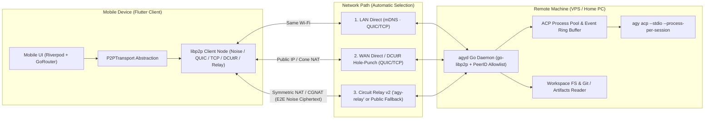

# Antigravity Mobile (`agy-mobile`) — Architecture & Implementation Plan

> **Status:** Design & UX Review Phase  
> **Target Stack:** Flutter (`agy_mobile`) · Go (`agyd` host daemon & `agy-relay`) · `libp2p` (Noise + Yamux + QUIC/TCP + mDNS + AutoNAT + DCUtR + Circuit Relay v2) · Antigravity CLI (`agy acp`)

---

## 1. System Architecture Overview

`antigravity-mobile` gives developers a mobile-native, end-to-end encrypted control plane for Antigravity CLI (`agy`) sessions running on remote machines (VPS, home workstations, laptops behind residential routers, or servers behind corporate/carrier symmetric NATs).

Rather than tunneling raw terminal ANSI streams over SSH or exposing ports/VPNs, the system pairs a **Flutter mobile client (`agy_mobile`)** directly with a **Go host daemon (`agyd`)** over **libp2p** and bridges structured agent conversations via Antigravity's native **Agent Client Protocol (`agy acp`)**.



### Core Components

1. **Remote Host Daemon (`agyd`, Go)**
   - Runs as a user/systemd service (`systemd --user`, `launchd`, or foreground CLI) on the developer's VPS, home PC, or laptop.
   - Embeds a persistent `go-libp2p` host with an Ed25519 identity (`~/.config/agyd/identity.key`) and strict `ConnectionGater` + PeerID allowlist (`authorized_peers.json`).
   - Spawns and supervises `agy acp --stdio --process-per-session` subprocesses, translating ACP JSON-RPC messages and `session/update` streams into resilient, sequence-numbered mobile events.
   - Serves supplementary host-native RPCs (sandboxed workspace browsing, git status/diffs, host telemetry, artifact retrieval, and paired peer management).

2. **Optional Self-Hosted Relay (`agy-relay`, Go)**
   - Single-binary `go-libp2p` node deployable on any cheap public VPS or Docker container (`--listen /ip4/0.0.0.0/tcp/4001 --listen /ip4/0.0.0.0/udp/4001/quic-v1`).
   - Runs **Circuit Relay v2 Hop** (`circuitv2/relay`), **AutoNAT v2 / NAT Service**, and lightweight peer discovery/rendezvous.
   - Configured with generous or infinite relay session limits (`relay.WithInfiniteLimits()` paired with an optional allowed-host PeerID ACL + token bucket) so symmetric NAT sessions are **never** dropped by public IPFS relays' 128 KB / 2-minute circuit caps.
   - Supports optional fallback to public libp2p/IPFS relays with transparent application-layer stream re-dialing if a self-hosted relay is not configured.

3. **Mobile Client (`agy_mobile`, Flutter)**
   - Cross-platform Android and iOS app rendering a mobile-first, structured UI over ACP streams (collapsible thinking blocks, tool call cards, inline diff previews, interactive permission approval cards, `@` file pickers, `/` slash command sheets, and live connection diagnostics).
   - Stores its Ed25519 identity key in hardware-backed secure storage (Android Keystore / iOS Keychain via `flutter_secure_storage`).

---

## 2. Antigravity CLI Integration Layer (`agy acp` Bridge)

### Verified Capabilities on Target Host

Probing `agy acp --stdio` on the development host (`Antigravity ACP Server v1.5.13`) confirmed the following protocol details:

- **Transport:** Line-delimited JSON-RPC 2.0 over `stdin`/`stdout`.
- **`initialize` Response:**
  - `protocolVersion`: `1`
  - `agentInfo`: `{ "name": "Antigravity ACP Server", "version": "1.5.13" }`
  - `agentCapabilities`:
    - `loadSession: true`
    - `promptCapabilities`: `{ "image": true, "audio": false, "embeddedContext": true }`
    - `sessionCapabilities`: `{ "resume": {}, "close": {}, "load": {}, "list": {}, "additionalDirectories": {} }`
  - `authMethods`: `oauth-personal`, `oauth-business`, `gemini-api-key`, `agent-platform`.
- **Auth Settling Behavior Observed:** When `agy acp --stdio` initializes, it loads existing OAuth credentials from `~/.gemini/antigravity-cli/antigravity-oauth-token`. Sending `session/list` within the same millisecond as `initialize` transiently returned `-32000 Authentication required`, whereas waiting briefly (~1s) after `initialize` returned the full active session list cleanly.
  - **Design Rule:** `agyd`'s ACP supervisor MUST perform a short readiness backoff/retry on transient `-32000` immediately after process startup, and only surface an `unauthenticated` host state to mobile if auth remains unavailable after startup settling (or if `antigravity-oauth-token` is absent).

### ACP Method Mapping

| ACP Method / Notification | Direction | How `agyd` Bridges It |
| :--- | :--- | :--- |
| `initialize` | `agyd -> agy` | Sent once on ACP worker boot; caches `agentCapabilities` and `authMethods`. |
| `session/list` | `mobile -> agyd -> agy` | Lists prior/active conversations (`sessionId`, `cwd`, `title`, `updatedAt`) enriched with `agyd` live status (`running`, `awaiting_permission`, `idle`). |
| `session/new` | `mobile -> agyd -> agy` | Starts a session in a selected remote `cwd` with `--mode`, `--model`, `--effort`, and optional `--sandbox` / `--add-dir`. |
| `session/load` / `session/resume` | `mobile -> agyd -> agy` | Re-attaches mobile to an existing conversation and replays missed ring-buffer events. |
| `session/prompt` | `mobile -> agyd -> agy` | Sends user text, `@` embedded file contexts, staged `/tmp` upload references, and chunked image attachments (transferred over `/agy/blob/1.0.0`). |
| `session/cancel` | `mobile -> agyd -> agy` | Triggered by the mobile Stop button to abort an in-flight turn gracefully. |
| `session/set_mode` | `mobile -> agyd -> agy` | Switches session mode (`auto`, `plan`, `accept-edits`) mid-conversation. |
| `session/update` | `agy -> agyd -> mobile` | Streamed incremental assistant chunks, collapsible thoughts, plan updates, and tool invocations wrapped in monotonic `seq` envelopes. |
| `session/request_permission` | `agy -> agyd -> mobile` | Held open by `agyd` as a pending approval record (persists across brief mobile disconnects!) until the user taps **Deny**, **Allow Once**, or **Always Allow**. |
| `session/close` | `mobile -> agyd -> agy` | Gracefully tears down idle worker processes. |

### Supplementary Host RPCs (Native to `agyd`)

Because ACP focuses strictly on agent messaging, `agyd` also exposes sandboxed host RPCs on `/agy/rpc/1.0.0`:

- `host/info`: hostname, OS/arch, CPU/RAM load, `agy` version, configured workspace roots, NAT reachability, active relay reservations, and RTT telemetry.
- `workspace/tree`, `workspace/read_file`: browse files for `@` context attachment and mobile inspection, strictly jailed to configured workspace roots or active session `cwd` (symlink-resolved `filepath.Clean` + prefix guard against path traversal).
- `workspace/upload_tmp`, `workspace/delete_tmp_file`: commit/manage arbitrary files uploaded from the mobile device into a per-session `/tmp` staging directory so they can be attached to chat prompts.
- `workspace/git_status`, `workspace/git_diff`: powers the mobile Workspace `Changes` tab and unified diff modal.
- `artifacts/list`, `artifacts/read`: reads session artifacts from `~/.gemini/antigravity-cli/brain/<session-id>/`.
- `peers/list`, `peers/revoke`: inspect and revoke paired mobile devices remotely.

### Mobile File Upload Staging (`/tmp`) & ACP Attachment

Users can pick any file from their mobile device (`file_picker` for logs, JSON, PDFs, source files, archives; `image_picker` for screenshots/photos) and attach it directly to a chat prompt:

1. **Chunked Transfer:** Flutter streams the file in 64 KB chunks over `/agy/blob/1.0.0` (with live progress UI and SHA-256 verification) and receives an upload handle.
2. **Isolated Staging Directory:** `agyd` sanitizes the filename (`filepath.Base` + short collision-safe prefix) and writes it to `<os.TempDir()>/agyd-uploads/<session-id>/<prefix>_<filename>` (`0700` dir, `0600` file), enforcing a configurable size limit (default `50 MB` per file / `250 MB` per session).
3. **ACP Context & Permissions:** `agyd` passes `<os.TempDir()>/agyd-uploads/<session-id>` via ACP `additionalDirectories` (supported by `agy acp`) so the agent can inspect uploaded files without triggering extra non-workspace permission prompts.
   - Supported images (`png`, `jpeg`, `webp`) are sent both as native ACP image blocks (`promptCapabilities.image: true`) and with their `/tmp` file path.
   - Arbitrary non-image files are injected into `session/prompt` with a structured reference block containing the staged `/tmp` path, original filename, byte size, and detected MIME type.
4. **Lifecycle Cleanup:** Staged files are automatically deleted on `session/close` and swept by a background TTL reaper (default `24h` idle), or immediately if the user removes a pending attachment (`workspace/delete_tmp_file`) before sending.

---

## 3. libp2p Connectivity & Universal NAT Traversal

### Connectivity Matrix

| Network Scenario | Discovery / Signaling | Transport Path | Expected Latency & Behavior |
| :--- | :--- | :--- | :--- |
| **1. Same Wi-Fi / LAN** | mDNS (`_agy._udp` / libp2p mDNS) + cached LAN multiaddrs | Direct QUIC v1 / TCP | `< 5 ms`, zero internet/relay hop |
| **2. VPS / Public IP / Port-Forward** | Cached WAN multiaddrs or Rendezvous | Direct WAN QUIC v1 / TCP | `10–60 ms`, direct encrypted socket |
| **3. Mobile LTE ↔ Cone NAT PC** | Circuit Relay v2 + **DCUtR** | Relayed start → **Direct hole-punched QUIC/TCP** | Relayed first (`~60 ms`), upgrades seamlessly to direct P2P in 1–3s |
| **4. Mobile Symmetric CGNAT ↔ Symmetric NAT PC** | Static `agy-relay` / AutoRelay + Rendezvous | **Circuit Relay v2** (`Hop`/`Stop`) | `40–120 ms`, permanently relayed; end-to-end **Noise** encrypted |

### Connection Lifecycle & NAT Traversal Sequence

```mermaid
sequenceDiagram
    autonumber
    participant M as Mobile (Symmetric CGNAT)
    participant R as agy-relay (Public IP, Circuit v2)
    participant H as agyd Host (Symmetric or Cone NAT)

    Note over H,R: Host Startup (Background)
    H->>R: Connect QUIC/TCP + AutoNAT probe
    R-->>H: Reachability: Private (Behind NAT)
    H->>R: Circuit Relay v2 RESERVE (/libp2p/circuit/relay/0.2.0/hop)
    R-->>H: Reservation granted (TTL refreshed periodically)

    Note over M,H: Mobile Connect (LTE -> Home PC)
    par Race Dial Direct + Relay
        M->>H: Try cached LAN / WAN direct addrs
    and
        M->>R: Dial /p2p/RelayID/p2p-circuit/p2p/HostID
        R->>H: Circuit STOP handshake
    end
    H-->>M: Noise XX Mutual Ed25519 Auth (E2E Encrypted)
    Note over M,H: Session immediately usable over Relay!

    Note over M,H: Background DCUtR Upgrade Attempt
    M->>H: /libp2p/dcutr Connect + Sync
    M-->>H: Simultaneous UDP/TCP hole-punch packets
    alt At least one side is Cone/Full NAT
        M->>H: Direct QUIC/TCP connection established!
        Note over M,H: New streams migrate to Direct; Relay stream gracefully drained
    else Both sides are Symmetric NAT
        Note over M,H: Hole punch times out silently; Circuit Relay v2 stays active uninterrupted
    end
```

### Critical `go-libp2p` Implementation Pitfalls & Safeguards

1. **Allowing Streams Over Relayed Connections (`ErrLimitedConn`)**
   - In `go-libp2p`, relayed connections carry the `Limited` transient flag (`network.WithAllowLimitedConn`). Opening a custom protocol stream without opting in fails immediately with `ErrLimitedConn`.
   - **Required implementation:** Both `agyd` and `agy_mobile` must pass `network.WithAllowLimitedConn(ctx, protocolID)` when opening `/agy/rpc/1.0.0`, `/agy/events/1.0.0`, and `/agy/blob/1.0.0` streams so symmetric NAT sessions never fail while relayed.

2. **Circuit Relay v2 Resource Limits (Public vs. Self-Hosted)**
   - Public libp2p/IPFS relays enforce strict default caps (typically 2 minutes duration and 128 KB per relayed connection).
   - **Self-Hosted `agy-relay`:** Uses `relay.WithInfiniteLimits()` (or high limits like 24h / multi-GB) gated by an optional `ConnectionGater` / PeerID allowlist so only the user's hosts/devices can consume unlimited relay bandwidth.
   - **Public Relay Fallback:** When no self-hosted relay is configured, `agyd` enables `AutoRelay` via DHT peer sources, and the client/daemon treats relay limit closures (`EOF` / `RESET`) as normal transient events—immediately opening a fresh relayed connection + requesting event replay from `last_seq`.

3. **Mobile Network Handoffs (Wi-Fi ↔ 5G/LTE & Background Sleep)**
   - Mobile OS transitions invalidate sockets without clean FIN packets.
   - Flutter monitors `connectivity_plus` and app lifecycle (`AppLifecycleState.resumed`), notifying the P2P engine to:
     1. Prune dead connections and cancel stale dial attempts.
     2. Re-bind UDP/TCP listeners on the new interface and refresh AutoNAT.
     3. Race-dial LAN mDNS → Direct WAN → Circuit Relay v2.
     4. Re-open `/agy/events/1.0.0` with `since_seq = lastSeenSeq` so zero ACP tokens or permission prompts are lost.

4. **Private Post-Pairing Relay Address Discovery**
   - When `agyd` runs with a self-hosted `agy-relay`, its relayed multiaddr (`/dns4/relay.example.com/udp/4001/quic-v1/p2p/<RelayID>/p2p-circuit/p2p/<HostID>`) is deterministic and embedded in the pairing QR.
   - When relying on dynamic public AutoRelay nodes (whose PeerIDs rotate), `agyd` publishes its current multiaddrs signed with its Ed25519 key to an **opaque Rendezvous/DHT key** derived via `HMAC-SHA256(shared_pairing_secret, "agy-rendezvous-v1")`, leaking zero plaintext user or host metadata to public DHT nodes.

---

## 4. Flutter libp2p Architecture Trade-Off (`P2PTransport`: `go-libp2p` vs. `dart_libp2p`)

Regardless of transport engine, the Flutter UI and Riverpod state layer interact solely through a clean `P2PTransport` Dart interface (`connect`, `disconnect`, `rpcCall`, `subscribeEvents`, `sendBlob`, `diagnosticsStream`, `retryHolePunch`).

| Criterion | **Option A: `go-libp2p` Core via Dart FFI / `c-shared`** | **Option B: Pure Dart (`dart_libp2p` `^4.12.2`)** |
| :--- | :--- | :--- |
| **Wire & Protocol Parity** | **100% identical** `go-libp2p` stack on mobile, `agyd`, and `agy-relay`. | Independent Dart implementation; cross-stack interop must be tested carefully. |
| **QUIC & Transports** | Full **QUIC v1** (UDP) + **TCP**, **Noise `XX`**, **Yamux**. | **TCP** + custom **`dart_udx`** (UDP). Does **not** speak standard libp2p QUIC v1, so mobile ↔ `agyd` runs over **TCP** (since `go-libp2p` does not speak `dart_udx`). |
| **NAT Hole Punching (DCUtR)** | Full **UDP (QUIC) + TCP DCUtR** hole punching + **AutoNAT v2**; UDP QUIC punches have a much higher success rate through residential/mobile NATs than TCP. | TCP DCUtR / relay only against `go-libp2p`; TCP simultaneous open fails more frequently on strict NATs, falling back to relay more often. |
| **Symmetric NAT Relaying** | Battle-tested `AutoRelay`, `circuitv2/client`, `WithAllowLimitedConn`, and mature stream reconnection. | Supports Circuit Relay v2 over TCP + Noise + Yamux; younger mobile Wi-Fi ↔ 5G handoff & NAT lifecycle maturity. |
| **Build Toolchain & Setup** | Requires **Android NDK** (`~/Android/Sdk/ndk` is **not yet installed** on this Linux dev machine — requires one `sdkmanager` install; iOS `.xcframework` requires macOS + Xcode) plus C-ABI glue in `pkg/mobilebridge`. | Pure `flutter build` toolchain (`pubspec.yaml` only); zero C/NDK cross-compiling. |
| **Binary / APK Size** | Adds ~12–18 MB per native ABI (Go runtime + `go-libp2p`). | Minimal pure-Dart footprint (~2–4 MB). |
| **Development Ergonomics** | `pkg/mobilebridge` maps Go callbacks to Dart `ReceivePort` isolates via `dart:ffi`. | Native Dart async streams and breakpoints directly in Flutter DevTools. |

**Recommendation:** Use **Option A (`go-libp2p` via `pkg/mobilebridge` + Dart FFI)** if you want **highest direct hole-punching success (QUIC v1 UDP)** and **rock-solid symmetric NAT Circuit Relay v2 parity** with `agyd`/`agy-relay`. Choose **Option B (`dart_libp2p`)** if you prioritize **pure-Dart build simplicity (no Android NDK)** and are comfortable relying on **TCP + self-hosted `agy-relay`** whenever direct TCP hole punching fails. Because both sit behind `P2PTransport`, the UI and ACP logic stay identical.

---

## 5. Cryptographic Pairing & Zero-Trust Security

1. **Persistent Identities:**
   - **Host (`agyd`):** Ed25519 keypair stored at `~/.config/agyd/identity.key` (`0600`).
   - **Mobile (`agy_mobile`):** Ed25519 keypair generated on first launch and stored in Android Keystore / iOS Keychain via `flutter_secure_storage`.
   - Every libp2p connection uses **Noise `XX`** authenticated directly against these PeerIDs (no self-signed TLS warning dialogs, no central auth server).

2. **Three Pairing Entry Flows (`agyd pair`):**
   - Running `agyd pair` generates a single-use 256-bit cryptographic pairing token (5-minute TTL) and outputs:
     - Terminal **QR code** + copyable **`agy://pair?peer=<HostPeerID>&token=<OneTimeToken>&relay=<Multiaddr>&lan=<Hint>&name=<Hostname>`** URI.
     - Short 6-digit **LAN PIN** when pairing over local mDNS discovery.
   - Mobile supports: **(a) Scan QR**, **(b) Nearby LAN (mDNS) + PIN**, and **(c) Paste Pairing URI**.

3. **Out-of-Band SAS Verification (MITM Protection):**
   - Mobile connects to `/agy/pair/1.0.0`, proves PeerID possession via Noise `XX`, and submits `{ token, device_name }`.
   - Both `agyd` and `agy_mobile` deterministically compute a **Short Authentication String (SAS)**:
     `SAS = SHA-256(hostPeerID || clientPeerID || token)` -> formatted as **6 digits + 3 emoji** (e.g., `742 — 918 · 🛰️ 🔐 ⚡`).
   - User visually confirms the SAS matches between terminal and phone, then taps **Confirm & Trust Host** (and confirms in terminal if interactive, or pre-armed via `agyd pair --trust-next`).
   - `agyd` writes `{ client_peer_id, device_name, paired_at, shared_rendezvous_secret }` to `authorized_peers.json` and immediately invalidates the pairing token.

4. **Strict Zero-Trust Enforcement:**
   - `agyd` installs a `go-libp2p` `ConnectionGater` / stream middleware on `/agy/rpc/1.0.0`, `/agy/events/1.0.0`, and `/agy/blob/1.0.0` that drops any connection or stream whose remote `PeerID` is absent from `authorized_peers.json`.
   - Relay nodes (`agy-relay`) only see Noise-encrypted packets and cannot read prompts, code, diffs, or permissions.
   - Remote device revocation (`agyd peers revoke <id>` or via Mobile Settings) immediately terminates active streams for that PeerID.

---

## 6. Wire Protocol & Mobile Resilience

All custom application protocols run over **Yamux-multiplexed Noise streams** using compact 4-byte big-endian length-prefixed frames:

| Protocol ID | Pattern | Payload & Resilience Design |
| :--- | :--- | :--- |
| `/agy/pair/1.0.0` | Request / Confirm | Ephemeral pairing handshake & SAS confirmation; disabled automatically when no active pairing token exists. |
| `/agy/rpc/1.0.0` | Request / Response | JSON-RPC 2.0 envelopes multiplexing ACP methods (`session/*`) and Host RPCs (`host/*`, `workspace/*`, `artifacts/*`, `peers/*`). |
| `/agy/events/1.0.0` | Server-push Stream | Client opens with `{ subscribe_sessions, since_seq }`. `agyd` streams `{ seq, session_id, ts, kind, payload }` from a bounded per-session ring buffer (e.g., last 2,000 events / disk-backed tail) so reconnects seamlessly catch up. |
| `/agy/blob/1.0.0` | Chunked Binary | 64 KB chunks with SHA-256 verification for mobile file uploads staged to remote `/tmp` (`agyd-uploads`), image attachments (`promptCapabilities.image: true`), and large git diffs/artifacts. |

- **Keepalive & Dead-Peer Detection:** Application-level heartbeat ping every `15s` with `45s` read deadline, immediately triggering reconnect on mobile wake.
- **Pending Permission Durability:** If the mobile app is backgrounded or loses signal when `agy acp` sends `session/request_permission`, `agyd` keeps the ACP request suspended safely and re-emits the unresolved permission card immediately upon stream resume (and optionally triggers a local mobile alert/notification when the app is active or in a foreground service).

---

## 7. Proposed Repository Layout & Implementation Phases

### Repository Layout

```text
antigravity-mobile/
├── docs/
│   ├── DESIGN_PLAN.md              # This architecture & implementation plan
│   └── ux-demo/                    # Interactive HTML/CSS/JS mobile UX prototype
├── server/                         # Go module (agyd + agy-relay + mobilebridge)
│   ├── go.mod
│   ├── cmd/
│   │   ├── agyd/                   # Remote host daemon CLI (run, pair, peers, status)
│   │   └── agy-relay/              # Lightweight public Circuit Relay v2 + AutoNAT server
│   └── pkg/
│       ├── p2p/                    # libp2p host, NAT traversal, ConnectionGater, rendezvous
│       ├── acp/                    # agy acp --stdio process manager, ring buffer, permissions
│       ├── pairing/                # Token generator, QR/URI encoder, SAS verifier, ACL store
│       ├── protocol/               # Wire codecs for /agy/{pair,rpc,events,blob}/1.0.0
│       ├── workspace/              # Sandboxed FS tree, file reader, git diff, brain artifacts
│       └── mobilebridge/           # C-shared FFI / gomobile bridge exposing P2PTransport
└── mobile/                         # Flutter app (Android & iOS)
    ├── pubspec.yaml
    └── lib/
        ├── core/transport/         # P2PTransport interface + FFI impl + mock loopback
        ├── core/crypto/            # Hardware keystore Ed25519 identity & URI/QR parser
        ├── features/hosts/         # Paired machines & Connection Diagnostics sheet
        ├── features/pairing/       # QR scanner, mDNS LAN discovery, SAS modal
        ├── features/sessions/      # Session list, filters, New Session sheet
        ├── features/chat/          # Streaming markdown, thoughts, tools, permission cards
        ├── features/workspace/     # Git diffs, remote file browser, brain artifacts
        └── features/settings/      # Relays, NAT policies, notifications, device revocation
```

### Phased Execution Roadmap

1. **Phase 1 — Go Core (`agyd`, `agy-relay`, `pkg/p2p`, `pkg/acp`, `pkg/pairing`)**
   - Implement persistent Ed25519 keys, PeerID allowlist `ConnectionGater`, pairing token + SAS handshake, and `agy-relay` binary.
   - Implement `pkg/acp` subprocess bridge for `agy acp --stdio` with startup auth-settling retry, `session/update` ring buffer, and durable `session/request_permission` queue.
   - **Verification:** Go unit tests + end-to-end integration test simulating a blocked direct dial forcing traffic through `agy-relay` with `WithAllowLimitedConn`, verifying ACP prompt streaming, permission allow/deny, and un-paired PeerID rejection.

2. **Phase 2 — Mobile P2P Bridge (`pkg/mobilebridge` & Flutter `P2PTransport`)**
   - Build C-shared / gomobile bindings (`android/arm64-v8a`, `ios/xcframework`, desktop `.so`/`.dylib` for fast local iteration) and wire the Dart `FfiP2PTransport` implementation + `MockP2PTransport`.
   - **Verification:** Standalone Go-to-Dart FFI integration test dialing a local `agyd` daemon directly and through `agy-relay`.

3. **Phase 3 — Flutter Mobile Client (`agy_mobile`)**
   - Implement the approved UX/UI screens, Riverpod state stores, secure storage, QR camera pairing (`mobile_scanner`), mDNS LAN discovery, streaming Markdown/code blocks, interactive permission cards, diff viewer, and Connection Diagnostics sheet.
   - **Verification:** `flutter analyze`, widget & state tests against `MockP2PTransport`, and live device/emulator test against `agyd`.

4. **Phase 4 — Hardening, Packaging & Field NAT Verification**
   - Add systemd unit generator (`agyd install-service`), Docker image for `agy-relay`, and real-world Wi-Fi ↔ cellular 5G handoff testing.

---

## 8. Review Status & Remaining Decision

- **Relay Strategy (`agy-relay` + optional public fallback):** **Confirmed** — will bundle the self-hosted `agy-relay` Go binary with unlimited ACL-gated relay limits plus optional public fallback.
- **UX/UI Prototype (`docs/ux-demo/`):** **Approved** as designed.
- **Mobile File Upload to Remote `/tmp` Directory:** **Added to Design** — chunked upload over `/agy/blob/1.0.0` into `<os.TempDir()>/agyd-uploads/<session-id>/` with ACP `additionalDirectories` registration and automatic session-close / 24h TTL cleanup.
- **Flutter libp2p Backend:** **Confirmed: Option A (`go-libp2p` via Dart FFI, Android `arm64-v8a` focus)** — provides full QUIC v1, UDP/TCP DCUtR hole punching, AutoNAT v2, and Circuit Relay v2 parity with `agyd` and `agy-relay`.
